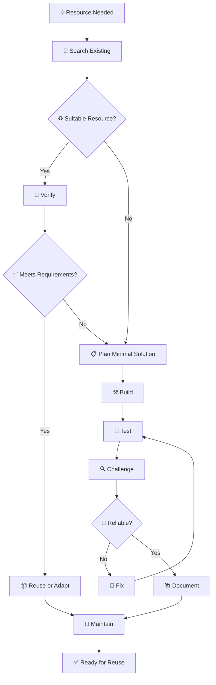
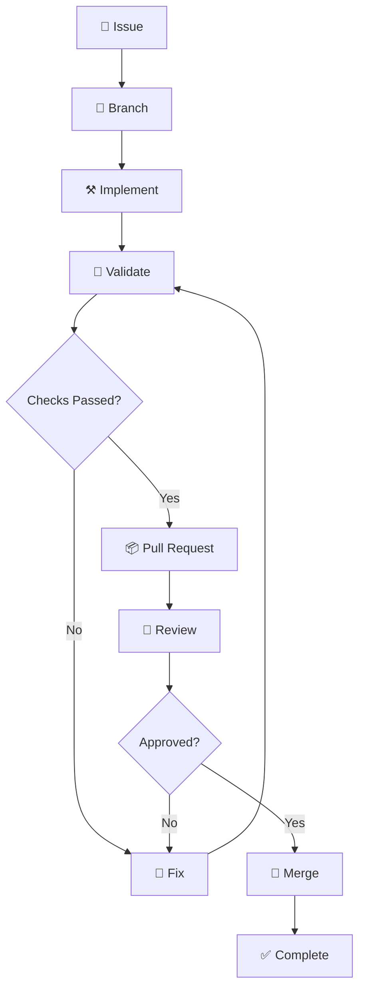

# 🔐 Dev Vault

**Reusable Engineering Resource Repository**

> Write once. Reuse wisely. Keep it simple.

কোড, স্ক্রিপ্ট, কনফিগারেশন, ডকুমেন্টেশন, প্রম্পট, কমান্ড ও ইঞ্জিনিয়ারিং প্যাটার্নের একটি সংগঠিত সংগ্রহ।

---

## 🚀 Quick Start

| বিষয় | নির্দেশনা |
| --- | --- |
| 🎯 Purpose | Reusable engineering resources সংরক্ষণ ও রক্ষণাবেক্ষণ |
| ♻️ Philosophy | Reuse before rebuild |
| 🧠 Approach | Simplicity, evidence ও maintainability |
| 🔐 Standard | Secure, documented ও verified |
| 🔄 Lifecycle | Discover → Verify → Reuse → Maintain |

নতুন কিছু তৈরি করার আগে দেখুন, প্রয়োজনীয় সমাধান ইতিমধ্যে আছে কি না।

---

## 📚 Contents

- 🧭 Introduction
- 🗂️ Repository Architecture
- 🔄 Resource Lifecycle
- 📏 Working Standards
- 🛠️ Engineering Workflow
- 📝 Commit Convention
- 🌿 Branch & Pull Request
- 🔐 Security Standards
- ♻️ Reuse & Maintenance
- 📄 Resource Documentation
- 🎯 Quality Standards
- 🤖 Automation
- 🤝 Contribution & Governance
- 🔒 Privacy & Ownership
- 🌱 Future Direction

---

## 🧭 Introduction

Dev Vault একটি reusable engineering resource repository।

এর উদ্দেশ্য হলো বিভিন্ন development project-এ বারবার প্রয়োজন হওয়া কার্যকর engineering resources এক জায়গায় সংরক্ষণ, যাচাই, উন্নয়ন ও পুনর্ব্যবহার করা।

### 📦 What belongs here?

- 💻 Reusable code snippets ও utility functions
- ⚙️ Automation scripts ও shell commands
- 🛠️ Configuration examples ও environment templates
- 📚 Technical documentation ও troubleshooting notes
- 🏗️ Architecture ও engineering patterns
- 🤖 AI prompts, agent instructions ও workflow templates
- 🧩 Project setup ও development templates
- 🔍 Auditing, testing ও maintenance utilities

### 🎯 Core Objective

একই সমস্যার সমাধান বারবার নতুন করে তৈরি না করে, বিদ্যমান সমাধান খুঁজে বের করা, যাচাই করা এবং প্রয়োজন অনুযায়ী ব্যবহার বা উন্নত করা।

> **Reuse before rebuild. Build only what is necessary.**

---

## 🗂️ Repository Architecture

```text
dev-vault/
│
├── snippets/          # Reusable code snippets
├── scripts/           # Automation and utility scripts
├── configs/           # Configuration examples
├── docs/              # Documentation and references
├── patterns/          # Engineering and architecture patterns
├── prompts/           # AI prompts and agent instructions
├── commands/          # CLI commands and workflows
├── templates/         # Reusable project and document templates
│
├── .github/
│   └── ISSUE_TEMPLATE/
│
├── README.md          # Repository landing page
└── .gitignore
```

এটি প্রস্তাবিত logical structure। Repository-তে কোনো directory বা file যুক্ত করার আগে তার প্রয়োজনীয়তা ও বর্তমান অবস্থান যাচাই করতে হবে।

### 📂 Directory Responsibilities

| Directory | Responsibility |
| --- | --- |
| `snippets/` | ছোট ও পুনর্ব্যবহারযোগ্য code |
| `scripts/` | Automation ও utility |
| `configs/` | Configuration templates |
| `docs/` | Technical documentation |
| `patterns/` | Engineering patterns |
| `prompts/` | AI ও agent instructions |
| `commands/` | Reusable CLI workflows |
| `templates/` | Project ও documentation templates |
| `.github/` | GitHub workflows ও contribution interfaces |

> **Organization rule:** ফাইলের extension নয়, তার প্রকৃত দায়িত্ব অনুযায়ী directory নির্বাচন করুন।

---

## 🔄 Resource Lifecycle

প্রতিটি resource সংগ্রহ, তৈরি, যাচাই ও পুনর্ব্যবহারের ক্ষেত্রে একই lifecycle অনুসরণ করবে।



### Lifecycle Principles

- 🔎 **Search first:** বিদ্যমান সমাধান খুঁজুন।
- 🧪 **Verify first:** শুধু file existence কার্যকারিতার প্রমাণ নয়।
- 🧩 **Build minimally:** প্রয়োজনের অতিরিক্ত কিছু তৈরি করবেন না।
- 🔍 **Challenge assumptions:** edge cases ও failure scenarios বিবেচনা করুন।
- 📚 **Document clearly:** ব্যবহার, dependency ও limitation লিখুন।
- 🔄 **Maintain deliberately:** বাস্তব প্রয়োজন অনুযায়ী update করুন।

---

## 📏 Working Standards

### ♻️ Reusability

- Resource-এর উদ্দেশ্য পরিষ্কার হতে হবে।
- অপ্রয়োজনীয় project-specific assumptions এড়িয়ে চলুন।
- Input, output ও dependency উল্লেখ করুন।
- একই কাজের duplicate implementation তৈরি করবেন না।

### 🧠 Simplicity

- সবচেয়ে সহজ কার্যকর সমাধানকে অগ্রাধিকার দিন।
- প্রয়োজন ছাড়া framework বা dependency যোগ করবেন না।
- অতিরিক্ত abstraction এড়িয়ে চলুন।
- "ভবিষ্যতে কাজে লাগতে পারে"—শুধু এই কারণে complexity তৈরি করবেন না।

### 🏷️ Naming Convention

**Preferred:**

```text
safe-json-parse.js
git-cleanup-workflow.md
docker-compose.example.yml
repository-audit.prompt.md
```

**Avoid:**

```text
test2.js
final-final.md
misc-stuff.txt
```

### 📚 Documentation

গুরুত্বপূর্ণ resource-এর ক্ষেত্রে প্রাসঙ্গিক তথ্য অন্তর্ভুক্ত করুন:

- Purpose
- Requirements
- Usage
- Examples
- Dependencies
- Limitations
- Validation status
- Security considerations

### 🧪 Code Quality

- প্রয়োজনীয় input validation রাখুন।
- যথাযথ error handling নিশ্চিত করুন।
- নিরাপদ default ব্যবহার করুন।
- অপ্রয়োজনীয় side effects এড়িয়ে চলুন।
- যাচাই ছাড়া PASS, Verified বা Production Ready দাবি করবেন না।

---

## 🛠️ Engineering Workflow

সব significant changes-এর ক্ষেত্রে:

```text
SCAN
  ↓
PLAN
  ↓
BUILD
  ↓
TEST
  ↓
VERIFY
  ↓
CHALLENGE
  ↓
FIX
  ↓
REVERIFY
  ↓
COMMIT
```

| Stage | Responsibility |
| --- | --- |
| SCAN | Existing resources ও dependencies পরীক্ষা |
| PLAN | Scope ও expected outcome নির্ধারণ |
| BUILD | প্রয়োজনীয় implementation |
| TEST | Functional ও relevant failure testing |
| VERIFY | Acceptance criteria যাচাই |
| CHALLENGE | Edge cases ও security review |
| FIX | শনাক্ত সমস্যার সমাধান |
| REVERIFY | সংশোধনের পর পুনরায় পরীক্ষা |
| COMMIT | যাচাইকৃত পরিবর্তন সংরক্ষণ |

### ✅ Verification Checklist

- [ ] সঠিক directory নির্বাচন করা হয়েছে।
- [ ] Naming ও purpose পরিষ্কার।
- [ ] Relevant documentation রয়েছে।
- [ ] প্রয়োজনীয় tests চালানো হয়েছে।
- [ ] Edge cases বিবেচনা করা হয়েছে।
- [ ] Security risks পর্যালোচনা করা হয়েছে।
- [ ] Duplicate implementation নেই।
- [ ] Verification claims বাস্তব ফলাফলের সঙ্গে সামঞ্জস্যপূর্ণ।

---

## 📝 Commit Convention

**Format:**

```text
<type>(<scope>): <description>
```

| Type | Purpose |
| --- | --- |
| `feat` | নতুন resource বা capability |
| `fix` | Bug correction |
| `docs` | Documentation |
| `refactor` | Implementation improvement |
| `test` | Testing |
| `chore` | Maintenance |
| `security` | Security improvement |

**Examples:**

```text
feat(snippets): add safe JSON parser
fix(scripts): handle missing input files
docs(configs): document environment variables
refactor(commands): simplify git workflow
test(snippets): cover invalid JSON input
chore(repo): organize reusable templates
security(configs): remove hardcoded credentials
```

> **Rule:** Commit message-এ পরিবর্তনের প্রকৃত উদ্দেশ্য স্পষ্ট করুন।

---

## 🌿 Branch & Pull Request

### Branch Naming

```text
feat/<description>
fix/<description>
docs/<description>
refactor/<description>
chore/<description>
```

### 🔄 Pull Request Workflow



### Pull Request Requirements

- [ ] Relevant issue linked.
- [ ] Clear PR title and description.
- [ ] Changes limited to the agreed scope.
- [ ] Relevant tests and checks passed.
- [ ] No credentials or sensitive data.
- [ ] Required review and approval obtained.

> 🚫 Required CI/CD checks, reviews or approval rules must never be bypassed.

---

## 🔐 Security Standards

Security is part of every resource, not an optional addition.

### ⛔ Never Commit

- API keys and access tokens
- Passwords and private keys
- Production credentials
- Personal `.env` files
- Confidential or unauthorized information

### 🛡️ Safe Environment Example

```dotenv
APP_ENV=development
APP_PORT=3000
API_BASE_URL=https://example.invalid
API_KEY=replace_with_your_own_key
```

### .gitignore Example

```gitignore
.env
.env.*
!.env.example

*.pem
*.key
secrets/
credentials/

node_modules/
dist/
build/

*.log
.tmp/
temp/

.DS_Store
Thumbs.db
```

প্রকল্পের প্রয়োজন অনুযায়ী ignore rules নির্ধারণ করুন। প্রয়োজনীয় source file যেন ভুল করে বাদ না পড়ে, তা যাচাই করুন।

> ⚠️ `.gitignore` ইতিমধ্যে commit হওয়া secret মুছে দেয় না। কোনো credential Git history-তে প্রকাশিত হলে সেটি **revoke বা rotate** করতে হবে।

---

## ♻️ Reuse & Maintenance

### 🔎 Reuse Before Rebuild

নতুন implementation তৈরির আগে:

1. Filename ও keyword দিয়ে অনুসন্ধান করুন।
2. Existing resource-এর functionality যাচাই করুন।
3. Dependencies ও limitations পর্যালোচনা করুন।
4. প্রয়োজন অনুযায়ী reuse বা adaptation করুন।

### 🧹 Avoid Duplication

একই উদ্দেশ্যের একাধিক resource পাওয়া গেলে:

1. তাদের behavior তুলনা করুন।
2. একটি canonical implementation নির্ধারণ করুন।
3. প্রয়োজনীয় alternatives document করুন।
4. নিরাপদ migration path ছাড়া পুরোনো resource সরাবেন না।

### 🔄 Maintenance Rules

- Outdated resource archive বা deprecate করুন।
- Dependency ও compatibility পরিবর্তন যাচাই করুন।
- Known limitations গোপন করবেন না।
- Unverified resource-কে verified হিসেবে চিহ্নিত করবেন না।
- Destructive changes-এর আগে impact যাচাই করুন।

---

## 📄 Resource Documentation

প্রয়োজন অনুযায়ী নিচের template ব্যবহার করুন:

```markdown
# Resource Name

## Purpose
What problem does it solve?

## Requirements
Runtime, dependencies and configuration.

## Usage
How to use it.

## Example
Input and expected output.

## Validation
Tests and verification performed.

## Limitations
Known issues and constraints.

## Security
Relevant security considerations.

## Maintenance
Compatibility and update notes.
```

প্রতিটি resource-এ সব section থাকা বাধ্যতামূলক নয়। প্রয়োজন অনুযায়ী ব্যবহার করুন।

---

## 🎯 Quality Standards

| Principle | Standard |
| --- | --- |
| 🧠 Simplicity First | অপ্রয়োজনীয় complexity নয় |
| ♻️ Reuse Before Rebuild | Duplicate implementation নয় |
| 🔍 Evidence First | প্রমাণ ছাড়া claims নয় |
| 🔐 Security by Default | শুরু থেকেই নিরাপদ আচরণ |
| 📦 Minimal Dependencies | প্রয়োজন ছাড়া dependency নয় |
| 📝 Explicit Limitations | সীমাবদ্ধতা স্পষ্টভাবে উল্লেখ |
| 🔄 Maintainability | ভবিষ্যতে পরিবর্তন সহজ রাখা |

### Definition of Done

একটি resource প্রস্তুত বলে বিবেচিত হবে যখন:

- [ ] Purpose ও usage পরিষ্কার।
- [ ] প্রয়োজনীয় verification সম্পন্ন।
- [ ] Known limitations document করা হয়েছে।
- [ ] Security considerations পর্যালোচিত।
- [ ] সঠিক directory-তে সংরক্ষিত।
- [ ] Reuse করার জন্য যথেষ্ট নির্দেশনা রয়েছে।

---

## 🤖 Automation

- Automation তখনই যুক্ত করুন, যখন তা বাস্তব উপকার দেয়।
- প্রয়োজন ছাড়া automation framework নয়।
- Destructive commands-এর আগে target যাচাই করুন।
- Script-এ meaningful exit status রাখুন।
- সম্ভব হলে dry-run support দিন।
- CI-তে প্রাসঙ্গিক lint, test ও security checks চালান।
- বাস্তব ফলাফল যাচাই ছাড়া automation success ঘোষণা করবেন না।

---

## 🤝 Contribution & Governance

Dev Vault-এর development ও maintenance একটি দীর্ঘমেয়াদি, structured workflow অনুসরণ করবে।

### 🌍 Contributor Experience

GitHub Issue Forms-এর মাধ্যমে সাতটি ভাষায় contribution গ্রহণের ব্যবস্থা থাকবে:

**English · বাংলা · 简体中文 · 日本語 · Русский · Español · Deutsch**

Contributor নিজের পছন্দের ভাষায় issue লিখতে পারবেন। GitHub স্বয়ংক্রিয়ভাবে issue translate করে না।

### 📋 Work Management

Repository development-এর জন্য একটি centralized GitHub Project ব্যবহৃত হবে:

```text
Dev Vault — Engineering & Maintenance
│
├── 📌 Issues
├── 🗺️ Milestones
├── 🔀 Pull Requests
└── ✅ Verified Changes
```

- **Project:** দীর্ঘমেয়াদি কাজের পরিকল্পনা ও tracking।
- **Milestone:** নির্দিষ্ট delivery phase।
- **Issue:** স্বাধীনভাবে পরিচালনাযোগ্য engineering task।
- **Pull Request:** পরিবর্তন review ও approval-এর মাধ্যম।

### Working Agreements

- Significant changes-এর জন্য issue তৈরি করুন।
- প্রতিটি issue-তে scope ও acceptance criteria নির্ধারণ করুন।
- বড় কাজকে ছোট, independently reviewable tasks-এ ভাগ করুন।
- Pull Request ছাড়া সরাসরি পরিবর্তন merge করবেন না—যেখানে PR workflow প্রযোজ্য।
- Required checks ও reviews সম্পন্ন করুন।
- Completion-এর আগে verification নিশ্চিত করুন।

---

## 🔒 Privacy & Ownership

- অনুমতি ছাড়া proprietary বা confidential resource সংরক্ষণ করবেন না।
- ব্যক্তিগত ও সংবেদনশীল তথ্য বাদ দিন।
- Third-party resource-এর license ও attribution অনুসরণ করুন।
- Public repository-তে প্রকাশের আগে files ও Git history পর্যালোচনা করুন।

---

## 🌱 Future Direction

Dev Vault প্রয়োজন অনুযায়ী ধাপে ধাপে উন্নত হবে।

সম্ভাব্য উন্নয়ন:

- 🏷️ Resource metadata ও tagging
- 🔎 Search ও resource indexing
- 🧪 Automated validation
- 🔐 Security checks
- 🧩 Reusable templates
- 🔄 Compatibility tracking
- 🧹 Duplicate resource detection

কোনো feature শুধু ভবিষ্যতে কাজে লাগতে পারে বলে তৈরি করা হবে না। বাস্তব প্রয়োজন, maintenance cost এবং measurable value বিবেচনা করে সিদ্ধান্ত নেওয়া হবে।

---

## 🧠 Engineering Philosophy

> **Store less. Reuse more. Verify everything.**

ছোট রিসোর্স। পরিষ্কার উদ্দেশ্য। যাচাইকৃত ফলাফল।

---

## 🔐 Dev Vault

*Write once. Reuse wisely. Keep it simple.*
