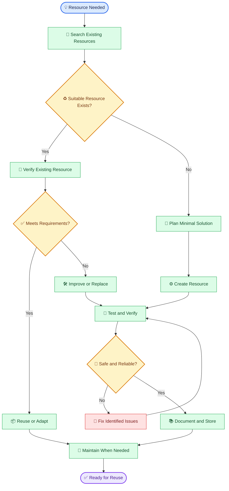
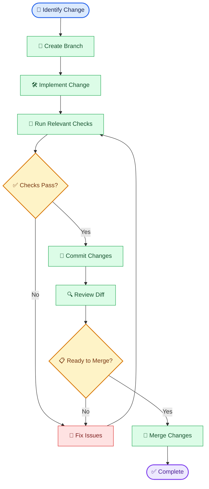

# 🔐 Dev Vault — সম্পূর্ণ ডকুমেন্টেশন

<div align="center">

**🌐 Language / ভাষা:** [English](./README.md) | [বাংলা](./README.bn.md)

*সম্পূর্ণ ইঞ্জিনিয়ারিং ডকুমেন্টেশন, স্ট্যান্ডার্ড এবং কার্যপ্রণালী।*

</div>

---

## 📖 সূচিপত্র

- [পরিচিতি](#-পরিচিতি)
- [Repository Architecture](#-repository-architecture)
- [Resource Lifecycle](#-resource-lifecycle)
- [Working Standards](#-working-standards)
- [Standard Workflow](#-standard-workflow)
- [Commit Convention](#-commit-convention)
- [Branch & Pull Request Policy](#-branch--pull-request-policy)
- [Security Standards](#-security-standards)
- [Reuse & Maintenance Policy](#-reuse--maintenance-policy)
- [Resource Documentation Template](#-resource-documentation-template)
- [Quality Principles](#-quality-principles)
- [Automation Policy](#-automation-policy)
- [Privacy & Ownership](#-privacy--ownership)
- [Future Evolution](#-future-evolution)

---

## 🧭 পরিচিতি

`dev-vault` হলো ব্যক্তিগত ইঞ্জিনিয়ারিং রিসোর্স সংরক্ষণ ও পুনর্ব্যবহারের জন্য তৈরি একটি repository।

এখানে এমন উপকরণ রাখা হবে, যেগুলো একাধিক প্রকল্পে কাজে লাগতে পারে:

- Reusable code snippets ও utility functions
- Automation scripts ও shell commands
- Configuration examples ও environment templates
- Engineering documentation ও troubleshooting notes
- Architecture patterns ও implementation references
- AI prompts, agent instructions ও workflow templates
- Project setup guides ও development checklists

### মূল লক্ষ্য

একই সমস্যা বারবার নতুন করে সমাধান না করে, আগে থেকে যাচাইকৃত উপকরণ খুঁজে বের করা, প্রয়োজন অনুযায়ী মানিয়ে নেওয়া এবং উন্নত করা।

> **Engineering principle:** নতুন কিছু তৈরি করার আগে দেখুন, প্রয়োজনীয় সমাধানটি ইতিমধ্যে আছে কি না।

---

## 🗂️ Repository Architecture

```text
dev-vault/
├── snippets/       # পুনর্ব্যবহারযোগ্য ছোট কোড
├── scripts/        # Automation ও utility scripts
├── configs/        # Configuration examples ও templates
├── docs/           # Documentation ও troubleshooting notes
├── patterns/       # Architecture ও engineering patterns
├── prompts/        # AI prompts ও agent instructions
├── commands/       # Reusable CLI commands ও workflows
├── templates/      # Project, issue ও documentation templates
├── README.md       # Repository guide ও working standards
└── .gitignore      # অপ্রয়োজনীয় ও সংবেদনশীল ফাইল বাদ দেওয়া
```

### Directory Responsibilities

| Directory | দায়িত্ব | উদাহরণ |
|---|---|---|
| `snippets/` | ছোট ও পুনর্ব্যবহারযোগ্য কোড | String helpers, validation |
| `scripts/` | পুনরাবৃত্ত কাজ স্বয়ংক্রিয় করা | Backup, cleanup, setup |
| `configs/` | নিরাপদ configuration templates | `.env.example`, lint config |
| `docs/` | ব্যাখ্যা ও সমস্যা সমাধানের নোট | Setup guides, troubleshooting |
| `patterns/` | বারবার কাজে লাগা design ও engineering patterns | Error handling, retry pattern |
| `prompts/` | AI-কে নির্দিষ্ট কাজের নির্দেশনা | Code review, repository audit |
| `commands/` | পুনর্ব্যবহারযোগ্য terminal workflows | Git aliases, CLI recipes |
| `templates/` | সাধারণ কাজের প্রস্তুত কাঠামো | Issue, PR, resource templates |

**Organization rule:** কোনো ফাইল রাখার আগে তার প্রকৃত দায়িত্ব অনুযায়ী সঠিক directory নির্বাচন করুন। শুধু ফাইলের extension দেখে directory নির্বাচন করবেন না।

---

## 🔄 Resource Lifecycle

একটি রিসোর্স সংগ্রহ থেকে পুনর্ব্যবহার ও রক্ষণাবেক্ষণ পর্যন্ত নিচের lifecycle অনুসরণ করবে।



### Lifecycle Rules

1. **Search first:** একই কাজের উপযোগী রিসোর্স আছে কি না খুঁজুন।
2. **Verify before reuse:** শুধু ফাইলের অস্তিত্বকে কার্যকারিতার প্রমাণ ধরে নেবেন না।
3. **Build minimally:** বিদ্যমান সমাধান যথেষ্ট না হলে যতটুকু দরকার, ততটুকুই তৈরি করুন।
4. **Test before storing:** সম্ভব হলে বাস্তবসম্মত input ও failure case দিয়ে যাচাই করুন।
5. **Document clearly:** ব্যবহার, নির্ভরতা, সীমাবদ্ধতা ও নিরাপত্তা-সংক্রান্ত তথ্য লিখুন।
6. **Maintain deliberately:** প্রয়োজন, bug বা compatibility issue দেখা দিলে রক্ষণাবেক্ষণ করুন।

---

## 📏 Working Standards

### 1. Reusability

- রিসোর্সটি কোন সমস্যার সমাধান করে, তা স্পষ্ট হতে হবে।
- সম্ভব হলে project-specific assumption কমিয়ে আনুন।
- প্রয়োজনীয় input, output ও dependency উল্লেখ করুন।
- অপ্রয়োজনীয় abstraction বা অতিরিক্ত configuration এড়িয়ে চলুন।

### 2. Simplicity

- সবচেয়ে সহজ কার্যকর সমাধানকে অগ্রাধিকার দিন।
- ছোট কাজের জন্য অপ্রয়োজনীয় framework বা dependency যোগ করবেন না।
- একই কাজের একাধিক implementation থাকলে যথার্থ কারণ ছাড়া সেগুলো সংরক্ষণ করবেন না।
- ভবিষ্যতে কাজে লাগতে পারে—শুধু এই যুক্তিতে অপ্রয়োজনীয় জটিলতা তৈরি করবেন না।

### 3. Naming

ফাইলের নাম এমন হতে হবে, যাতে বিষয়বস্তু ও উদ্দেশ্য বোঝা যায়।

**ভালো উদাহরণ:**
- `safe-json-parse.js`
- `git-cleanup-workflow.md`
- `docker-compose.example.yml`
- `repository-audit.prompt.md`

**এড়িয়ে চলুন:**
- `test2.js`
- `final-final-new.md`
- `misc-stuff.txt`

### 4. Documentation

প্রয়োজন অনুযায়ী প্রতিটি গুরুত্বপূর্ণ রিসোর্সে উল্লেখ করুন:

- উদ্দেশ্য ও ব্যবহারক্ষেত্র
- প্রয়োজনীয়তা ও dependencies
- ব্যবহারবিধি ও উদাহরণ
- Input/output behavior
- পরিচিত সীমাবদ্ধতা
- যাচাইয়ের অবস্থা ও প্রাসঙ্গিক তারিখ

### 5. Code Quality

- প্রাসঙ্গিক error handling রাখুন।
- Input validation প্রয়োজন হলে তা নিশ্চিত করুন।
- নিরাপদ default ব্যবহার করুন।
- অপ্রয়োজনীয় side effect এড়িয়ে চলুন।
- বিদ্যমান আচরণ পরিবর্তন হলে তা নথিভুক্ত করুন।
- পরীক্ষার ফল যাচাই না করে `PASS` বা `Verified` দাবি করবেন না।

### 6. Configuration

- বাস্তব secret বা ব্যক্তিগত credential commit করবেন না।
- প্রয়োজনে placeholder-সহ example configuration রাখুন।
- কোন variable বাধ্যতামূলক, তা document করুন।
- Environment-specific পার্থক্য স্পষ্ট করুন।

---

## 🔬 Standard Workflow

Repository-তে নতুন রিসোর্স যোগ করা বা বিদ্যমান রিসোর্স পরিবর্তনের সময় এই workflow অনুসরণ করুন:

```text
SCAN → PLAN → BUILD → TEST → VERIFY → CHALLENGE → FIX → REVERIFY → COMMIT
```

| ধাপ | কাজ |
|---|---|
| `SCAN` | বিদ্যমান রিসোর্স, dependencies ও constraints পরীক্ষা |
| `PLAN` | ন্যূনতম পরিবর্তন ও প্রত্যাশিত ফল নির্ধারণ |
| `BUILD` | রিসোর্স তৈরি বা পরিবর্তন |
| `TEST` | প্রাসঙ্গিক test ও ব্যবহারিক পরীক্ষা |
| `VERIFY` | প্রত্যাশিত ফল ও acceptance criteria যাচাই |
| `CHALLENGE` | edge case, security ও failure mode পর্যালোচনা |
| `FIX` | শনাক্ত সমস্যার সমাধান |
| `REVERIFY` | পরিবর্তনের পর আবার পরীক্ষা |
| `COMMIT` | যাচাইকৃত পরিবর্তন অর্থবহ commit-এ সংরক্ষণ |

### Verification Checklist

- [ ] রিসোর্সটি সঠিক directory-তে আছে।
- [ ] নাম ও উদ্দেশ্য পরিষ্কার।
- [ ] প্রয়োজনীয় documentation আছে।
- [ ] প্রাসঙ্গিক test চালানো হয়েছে।
- [ ] সম্ভাব্য error ও edge case বিবেচনা করা হয়েছে।
- [ ] কোনো secret বা সংবেদনশীল তথ্য যুক্ত হয়নি।
- [ ] অপ্রয়োজনীয় dependency বা duplicate implementation নেই।
- [ ] পরিবর্তনের দাবি বাস্তব verification-এর সঙ্গে সামঞ্জস্যপূর্ণ।

---

## 📝 Commit Convention

Commit message সংক্ষিপ্ত, অর্থবহ ও পরিবর্তনের প্রকৃতি অনুযায়ী লিখুন।

**Format:**

```text
<type>(<scope>): <short description>
```

| Type | ব্যবহার |
|---|---|
| `feat` | নতুন রিসোর্স বা capability |
| `fix` | bug বা ভুল আচরণ সংশোধন |
| `docs` | Documentation পরিবর্তন |
| `refactor` | আচরণ না বদলে implementation উন্নত করা |
| `test` | Test যোগ বা সংশোধন |
| `chore` | Maintenance ও repository housekeeping |
| `security` | Security-related improvement |

### Examples

```text
feat(snippets): add safe JSON parsing utility
fix(scripts): handle missing input file
docs(configs): document required environment variables
refactor(commands): simplify git cleanup workflow
test(snippets): cover invalid JSON input
chore(repo): organize reusable templates
security(configs): replace hardcoded credential example
```

**Rule:** Commit message-এ কী পরিবর্তন হয়েছে, তা লিখুন; অস্পষ্ট শব্দ যেমন `update`, `changes` বা `final fix` একা ব্যবহার করবেন না।

---

## 🌿 Branch & Pull Request Policy

ছোট ও ব্যক্তিগত repository হলেও পরিবর্তনগুলো পর্যালোচনাযোগ্য রাখা উচিত।

### Recommended Branch Naming

```text
feat/<short-description>
fix/<short-description>
docs/<short-description>
refactor/<short-description>
chore/<short-description>
```

### Recommended Workflow



### Pull Request Checklist

- [ ] PR title Conventional Commit format অনুসরণ করে।
- [ ] পরিবর্তনের উদ্দেশ্য ও প্রভাব বর্ণনা করা হয়েছে।
- [ ] Relevant tests বা checks-এর ফল উল্লেখ করা হয়েছে।
- [ ] Unrelated পরিবর্তন বাদ দেওয়া হয়েছে।
- [ ] Secret, credential বা ব্যক্তিগত তথ্য নেই।
- [ ] Review-এর পরই merge করা হয়েছে।

**Merge policy:** CI, workflow বা প্রয়োজনীয় validation এড়িয়ে merge করবেন না। Repository-তে প্রযোজ্য protection rules থাকলে সেগুলো অনুসরণ করুন।

---

## 🔐 Security Standards

Security এই repository-র প্রতিটি রিসোর্সের অংশ।

### Never Commit

- API keys বা access tokens
- Password, private keys বা session secrets
- ব্যক্তিগত `.env` ফাইল
- Production credentials
- অনুমতি ছাড়া সংগ্রহ করা ব্যক্তিগত বা গোপন তথ্য

### Safe Environment Example

`.env.example`-এ বাস্তব credential-এর পরিবর্তে placeholder ব্যবহার করুন:

```dotenv
APP_ENV=development
APP_PORT=3000
API_BASE_URL=https://example.invalid
API_KEY=replace_with_your_own_key
```

### Example `.gitignore`

```gitignore
# Environment secrets
.env
.env.*
!.env.example

# Private keys and credentials
*.pem
*.key
secrets/
credentials/

# Dependencies and build output
node_modules/
dist/
build/

# Logs and temporary files
*.log
.tmp/
temp/

# Local editor and OS files
.DS_Store
Thumbs.db
.vscode/
.idea/
```

প্রকল্পের প্রয়োজন অনুযায়ী `.gitignore` পরিবর্তন করুন। অন্ধভাবে সব pattern যোগ করবেন না—কোনো প্রয়োজনীয় source বা template যেন বাদ না পড়ে।

> **Security warning:** `.gitignore` কেবল ভবিষ্যতে untracked ফাইল commit হওয়া ঠেকাতে সাহায্য করে। কোনো secret ইতিমধ্যে Git history-তে যুক্ত হয়ে গেলে সেটি নিরাপদে সরানো হয়েছে ধরে নেওয়া যাবে না। সংশ্লিষ্ট credential revoke বা rotate করুন এবং প্রয়োজনে repository history পরিষ্কার করুন।

---

## ♻️ Reuse & Maintenance Policy

### Reuse Before Rebuild

নতুন implementation তৈরির আগে repository-তে keyword, filename ও directory ধরে অনুসন্ধান করুন।

### Avoid Duplication

একই কাজের একাধিক রিসোর্স থাকলে:

1. তাদের উদ্দেশ্য ও behavior তুলনা করুন।
2. কোনটি নির্ভরযোগ্য ও বর্তমান, তা যাচাই করুন।
3. প্রয়োজন হলে একটি canonical resource নির্ধারণ করুন।
4. বিকল্প implementation-এর বাস্তব প্রয়োজন থাকলে তার পার্থক্য document করুন।
5. নিরাপদ migration path ছাড়া পুরোনো রিসোর্স মুছবেন না।

### Maintenance Rules

- কাজের উপযোগিতা হারালে archive বা deprecate করুন।
- dependency বা API পরিবর্তন হলে compatibility যাচাই করুন।
- Known limitations গোপন করবেন না।
- পরীক্ষা না করা রিসোর্সকে পরীক্ষিত হিসেবে চিহ্নিত করবেন না।
- কোনো পরিবর্তনের সম্ভাব্য প্রভাব বুঝে তারপর সংশোধন করুন।

---

## 📄 Resource Documentation Template

নতুন গুরুত্বপূর্ণ রিসোর্সের জন্য এই template ব্যবহার করতে পারেন:

```markdown
# Resource Name

## Purpose
কোন সমস্যার সমাধান করে?

## Use Cases
কোন পরিস্থিতিতে ব্যবহার উপযোগী?

## Requirements
প্রয়োজনীয় runtime, dependency বা configuration কী?

## Usage
কীভাবে ব্যবহার করতে হবে?

## Example
বাস্তবসম্মত input ও expected output।

## Validation
কোন test বা verification করা হয়েছে?

## Limitations
পরিচিত সীমাবদ্ধতা বা edge case কী?

## Security Notes
কোনো security consideration আছে কি?

## Maintenance
পরবর্তী update বা compatibility সংক্রান্ত নোট।
```

সব রিসোর্সে প্রতিটি section থাকা বাধ্যতামূলক নয়। রিসোর্সের গুরুত্ব ও জটিলতা অনুযায়ী প্রাসঙ্গিক অংশগুলো রাখুন।

---

## 🎯 Quality Principles

| Principle | অর্থ |
|---|---|
| Simplicity First | অপ্রয়োজনীয় জটিলতা এড়ানো |
| Reuse Before Rebuild | বিদ্যমান সমাধান আগে খোঁজা |
| Evidence Before Claims | প্রমাণ ছাড়া verification দাবি না করা |
| Security by Default | শুরু থেকেই নিরাপদ আচরণ |
| Minimal Dependencies | প্রয়োজন ছাড়া dependency যোগ না করা |
| Explicit Limitations | সীমাবদ্ধতা স্পষ্টভাবে জানানো |
| Safe Changes | পরিবর্তনের আগে ও পরে প্রভাব যাচাই |
| Maintainability | ভবিষ্যতে বোঝা ও পরিবর্তন করা সহজ রাখা |

### Definition of Done

কোনো রিসোর্স তখনই প্রস্তুত বলে বিবেচিত হবে, যখন:

- এর উদ্দেশ্য ও ব্যবহার স্পষ্ট;
- প্রয়োজনীয় verification সম্পন্ন;
- পরিচিত সমস্যা ও সীমাবদ্ধতা নথিভুক্ত;
- নিরাপত্তা-সংক্রান্ত ঝুঁকি পর্যালোচিত;
- সঠিক স্থানে সংরক্ষিত;
- পুনর্ব্যবহারের জন্য পর্যাপ্ত নির্দেশনা রয়েছে।

---

## 🤖 Automation Policy

Automation ব্যবহার করুন তখনই, যখন এটি পুনরাবৃত্ত কাজের নির্ভরযোগ্যতা বাড়ায় বা উল্লেখযোগ্য সময় বাঁচায়।

- ছোট কাজের জন্য অপ্রয়োজনীয় automation framework তৈরি করবেন না।
- Destructive command-এর আগে target ও প্রভাব যাচাই করুন।
- Script-এ error handling ও meaningful exit status রাখুন।
- সম্ভব হলে destructive action-এর আগে dry-run option দিন।
- CI-তে প্রাসঙ্গিক lint, test ও security checks চালান।
- Automation-এর ফল বাস্তবে যাচাই না করে success ঘোষণা করবেন না।

---

## 🔒 Privacy & Ownership

- Repository-তে শুধু নিজের সংরক্ষণের অধিকার আছে এমন উপকরণ রাখুন।
- অন্যের proprietary code বা confidential document অনুমতি ছাড়া সংরক্ষণ করবেন না।
- ব্যক্তিগত বা সংবেদনশীল তথ্য যতটা সম্ভব বাদ দিন।
- Third-party resource ব্যবহার করলে প্রযোজ্য license ও attribution requirement অনুসরণ করুন।
- Public repository-তে প্রকাশ করার আগে সব ফাইল ও Git history পর্যালোচনা করুন।

---

## 🧱 Future Evolution

`dev-vault` প্রয়োজন অনুযায়ী ধাপে ধাপে উন্নত হবে।

সম্ভাব্য ভবিষ্যৎ উন্নয়ন:

- Resource metadata ও tagging convention
- Automated Markdown ও configuration validation
- Reusable resource index
- Script testing ও linting workflow
- Dependency ও security checks
- Versioned templates এবং compatibility notes
- Duplicate resource detection

**কোনো feature শুধু ভবিষ্যতে কাজে লাগতে পারে বলে যোগ করা হবে না।** বাস্তব প্রয়োজন, রক্ষণাবেক্ষণের খরচ ও স্পষ্ট উপকারিতা বিবেচনা করে সিদ্ধান্ত নেওয়া হবে।

---

<div align="center">

### 🧠 Engineering Philosophy

**Store less. Reuse more. Verify everything.**

*ছোট রিসোর্স, পরিষ্কার উদ্দেশ্য, যাচাইকৃত ফলাফল।*

---

[⬅️ রিপোজিটরি হোমে ফিরুন](../README.md) · [English Documentation](./README.md)

</div>
