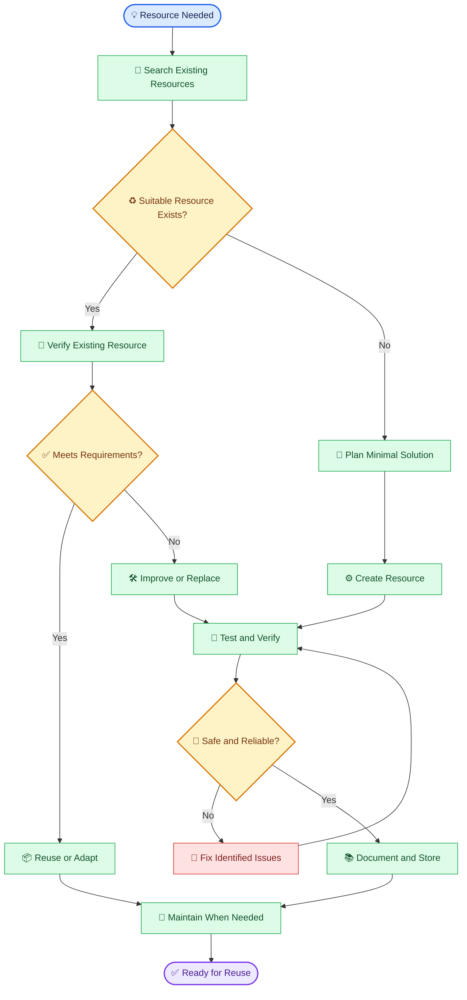
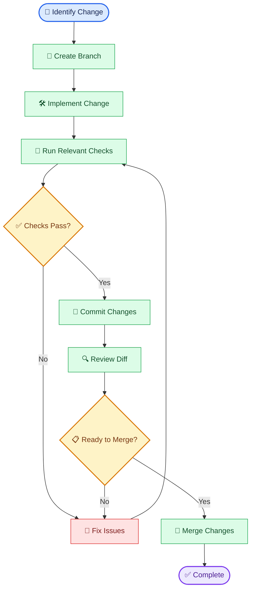

# 🔐 Dev Vault — Complete Documentation

<div align="center">

**🌐 Language / ভাষা:** [English](./README.md) | [বাংলা](./README.bn.md)

*Full engineering documentation, standards, and working principles.*

</div>

---

## 📖 Table of Contents

- [Introduction](#-introduction)
- [Repository Architecture](#-repository-architecture)
- [Resource Lifecycle](#-resource-lifecycle)
- [Working Standards](#-working-standards)
- [Standard Workflow](#-standard-workflow)
- [Commit Convention](#-commit-convention)
- [Branch & Pull Request Policy](#-branch--pull-request-policy)
- [Security Standards](#-security-standards)
- [Reuse & Maintenance Policy](#-reuse--maintenance-policy)
- [Resource Documentation Template](#-resource-documentation-template)
- [Quality Principles](#-quality-principles)
- [Automation Policy](#-automation-policy)
- [Privacy & Ownership](#-privacy--ownership)
- [Future Evolution](#-future-evolution)

---

## 🧭 Introduction

`dev-vault` is a personal repository for storing and reusing engineering resources.

It holds materials that can serve multiple projects:

- Reusable code snippets and utility functions
- Automation scripts and shell commands
- Configuration examples and environment templates
- Engineering documentation and troubleshooting notes
- Architecture patterns and implementation references
- AI prompts, agent instructions, and workflow templates
- Project setup guides and development checklists

### Core Objective

Rather than re-solving the same problem repeatedly, search for previously verified materials, adapt them as needed, and improve them over time.

> **Engineering principle:** Before building something new, check whether a suitable solution already exists.

---

## 🗂️ Repository Architecture

```text
dev-vault/
├── snippets/       # Reusable, single-purpose code
├── scripts/        # Automation and utility scripts
├── configs/        # Configuration examples and templates
├── docs/           # Documentation and troubleshooting notes
├── patterns/       # Architecture and engineering patterns
├── prompts/        # AI prompts and agent instructions
├── commands/       # Reusable CLI commands and workflows
├── templates/      # Project, issue, and documentation templates
├── README.md       # Repository guide and working standards
└── .gitignore      # Exclusion rules for sensitive and generated files
```

### Directory Responsibilities

| Directory | Responsibility | Examples |
|---|---|---|
| `snippets/` | Small, reusable code | String helpers, validators |
| `scripts/` | Automate recurring tasks | Backup, cleanup, setup |
| `configs/` | Safe configuration templates | `.env.example`, lint configs |
| `docs/` | Explanations and troubleshooting | Setup guides, runbooks |
| `patterns/` | Recurring design patterns | Error handling, retry logic |
| `prompts/` | AI task instructions | Code review, repo audit |
| `commands/` | Reusable terminal workflows | Git aliases, CLI recipes |
| `templates/` | Pre-built scaffolds | Issue, PR, resource templates |

> **Organization rule:** Choose a directory based on the resource's *responsibility*, not its file extension.

---

## 🔄 Resource Lifecycle

Every resource follows a deliberate lifecycle from identification to reuse.



### Lifecycle Rules

1. **Search first** — Look for an existing resource before building.
2. **Verify before reuse** — Existence is not proof of correctness.
3. **Build minimally** — Solve only what is necessary.
4. **Test before storing** — Use realistic inputs and failure cases.
5. **Document clearly** — Usage, dependencies, limitations, and security.
6. **Maintain deliberately** — Update when needs, bugs, or compatibility change.

---

## 📏 Working Standards

### 1. Reusability

- Clearly state the problem the resource solves
- Minimize project-specific assumptions
- Document inputs, outputs, and dependencies
- Avoid unnecessary abstraction or configuration

### 2. Simplicity

- Prefer the simplest effective solution
- Do not introduce frameworks or dependencies for trivial tasks
- Do not duplicate implementations without documented reason
- Do not add complexity for hypothetical future needs

### 3. Naming

File names must convey purpose and content.

**Good:**
- `safe-json-parse.js`
- `git-cleanup-workflow.md`
- `docker-compose.example.yml`
- `repository-audit.prompt.md`

**Avoid:**
- `test2.js`
- `final-final-new.md`
- `misc-stuff.txt`

### 4. Documentation

For important resources, document:

- Purpose and use cases
- Requirements and dependencies
- Usage and examples
- Input/output behavior
- Known limitations
- Verification status and relevant dates

### 5. Code Quality

- Include appropriate error handling
- Validate inputs where necessary
- Use safe defaults
- Avoid unnecessary side effects
- Document breaking behavior changes
- Never claim `PASS` or `Verified` without actual verification

### 6. Configuration

- Never commit real secrets or personal credentials
- Provide `*.example` configuration templates
- Document mandatory variables
- Make environment-specific differences explicit

---

## 🔬 Standard Workflow

Follow this workflow when adding or modifying a resource:

```text
SCAN → PLAN → BUILD → TEST → VERIFY → CHALLENGE → FIX → REVERIFY → COMMIT
```

| Phase | Action |
|---|---|
| `SCAN` | Inspect existing resources, dependencies, constraints |
| `PLAN` | Define minimal change and expected outcome |
| `BUILD` | Create or modify the resource |
| `TEST` | Run relevant tests and practical checks |
| `VERIFY` | Confirm expected outcomes and acceptance criteria |
| `CHALLENGE` | Review edge cases, security, and failure modes |
| `FIX` | Resolve identified issues |
| `REVERIFY` | Re-test after changes |
| `COMMIT` | Save verified changes in a meaningful commit |

### Verification Checklist

- [ ] Resource is in the correct directory
- [ ] Name and purpose are clear
- [ ] Required documentation exists
- [ ] Relevant tests have been run
- [ ] Error and edge cases considered
- [ ] No secrets or sensitive data added
- [ ] No unnecessary dependencies or duplicates
- [ ] Claims match actual verification

---

## 📝 Commit Convention

Commit messages follow [Conventional Commits](https://www.conventionalcommits.org/).

**Format:**

```text
<type>(<scope>): <short description>
```

| Type | Purpose |
|---|---|
| `feat` | New resource or capability |
| `fix` | Bug or incorrect behavior fix |
| `docs` | Documentation changes |
| `refactor` | Implementation improvement without behavior change |
| `test` | Adding or updating tests |
| `chore` | Maintenance and housekeeping |
| `security` | Security-related improvement |

### Examples

```text
feat(snippets): add safe JSON parsing utility
fix(scripts): handle missing input file
docs(configs): document required environment variables
refactor(commands): simplify git cleanup workflow
test(snippets): cover invalid JSON input
chore(repo): organize reusable templates
security(configs): replace hardcoded credential example
```

> **Rule:** Describe *what changed* — avoid vague messages like `update` or `final fix` alone.

---

## 🌿 Branch & Pull Request Policy

Even for a personal repository, changes should remain reviewable.

### Branch Naming

```text
feat/<short-description>
fix/<short-description>
docs/<short-description>
refactor/<short-description>
chore/<short-description>
```

### Recommended Workflow



### Pull Request Checklist

- [ ] PR title follows Conventional Commit format
- [ ] Purpose and impact are described
- [ ] Relevant test/check results are included
- [ ] Unrelated changes are excluded
- [ ] No secrets, credentials, or personal data
- [ ] Merged only after review

> **Merge policy:** Never bypass CI, workflows, or required validation.

---

## 🔐 Security Standards

Security is part of every resource.

### Never Commit

- API keys or access tokens
- Passwords, private keys, or session secrets
- Personal `.env` files
- Production credentials
- Private or confidential data without authorization

### Safe Environment Example

Use placeholders in `.env.example`:

```dotenv
APP_ENV=development
APP_PORT=3000
API_BASE_URL=https://example.invalid
API_KEY=replace_with_your_own_key
```

### Example `.gitignore`

```gitignore
# Environment secrets
.env
.env.*
!.env.example

# Private keys and credentials
*.pem
*.key
secrets/
credentials/

# Dependencies and build output
node_modules/
dist/
build/

# Logs and temporary files
*.log
.tmp/
temp/

# Local editor and OS files
.DS_Store
Thumbs.db
.vscode/
.idea/
```

> **Security warning:** `.gitignore` only prevents future tracking. If a secret has already entered Git history, assume it is compromised — revoke or rotate the credential and consider history cleanup.

---

## ♻️ Reuse & Maintenance Policy

### Reuse Before Rebuild

Before creating a new implementation, search by keyword, filename, and directory.

### Avoid Duplication

When multiple resources solve the same problem:

1. Compare their purpose and behavior
2. Verify which is reliable and current
3. Designate a canonical resource if needed
4. Document meaningful differences
5. Do not delete older resources without a safe migration path

### Maintenance Rules

- Archive or deprecate resources that lose utility
- Re-verify compatibility when dependencies or APIs change
- Never hide known limitations
- Never mark untested resources as tested
- Understand the impact before making changes

---

## 📄 Resource Documentation Template

Use this template for important new resources:

```markdown
# Resource Name

## Purpose
What problem does this solve?

## Use Cases
When is this appropriate?

## Requirements
Required runtime, dependencies, or configuration?

## Usage
How to use it?

## Example
Realistic input and expected output.

## Validation
What tests or verification were performed?

## Limitations
Known constraints or edge cases?

## Security Notes
Any security considerations?

## Maintenance
Notes on updates or compatibility.
```

Not every section is mandatory — include sections proportional to the resource's importance and complexity.

---

## 🎯 Quality Principles

| Principle | Meaning |
|---|---|
| **Simplicity First** | Avoid unnecessary complexity |
| **Reuse Before Rebuild** | Search before building |
| **Evidence Before Claims** | Never claim verification without evidence |
| **Security by Default** | Safe behavior from the start |
| **Minimal Dependencies** | Add only what is necessary |
| **Explicit Limitations** | State constraints clearly |
| **Safe Changes** | Verify impact before and after |
| **Maintainability** | Easy to understand and modify |

### Definition of Done

A resource is ready only when:

- ✅ Purpose and usage are clear
- ✅ Required verification is complete
- ✅ Known issues and limitations are documented
- ✅ Security risks are reviewed
- ✅ Stored in the correct location
- ✅ Sufficient guidance for reuse exists

---

## 🤖 Automation Policy

Automate only when it improves reliability or saves meaningful time.

- Do not build automation frameworks for trivial tasks
- Verify targets and impact before destructive commands
- Include error handling and meaningful exit status
- Provide dry-run options for destructive actions
- Run relevant lint, test, and security checks in CI
- Never declare success without verifying real outcomes

---

## 🔒 Privacy & Ownership

- Store only content you have the right to preserve
- Do not store proprietary or confidential material without permission
- Minimize personal or sensitive information
- Follow applicable license and attribution requirements for third-party resources
- Review all files and Git history before publishing publicly

---

## 🧱 Future Evolution

`dev-vault` will evolve in deliberate, minimal steps.

Possible future improvements:

- Resource metadata and tagging conventions
- Automated Markdown and configuration validation
- Searchable reusable resource index
- Script testing and linting workflow
- Dependency and security scanning
- Versioned templates with compatibility notes
- Duplicate resource detection

> **Scope discipline:** Features are added only when backed by real need, clear benefit, and sustainable maintenance cost.

---

<div align="center">

### 🧠 Engineering Philosophy

**Store less. Reuse more. Verify everything.**

*Small resources, clear purpose, verified outcomes.*

---

[⬅️ Back to Repository Home](../README.md) · [বাংলা ডকুমেন্টেশন](./README.bn.md)

</div>
